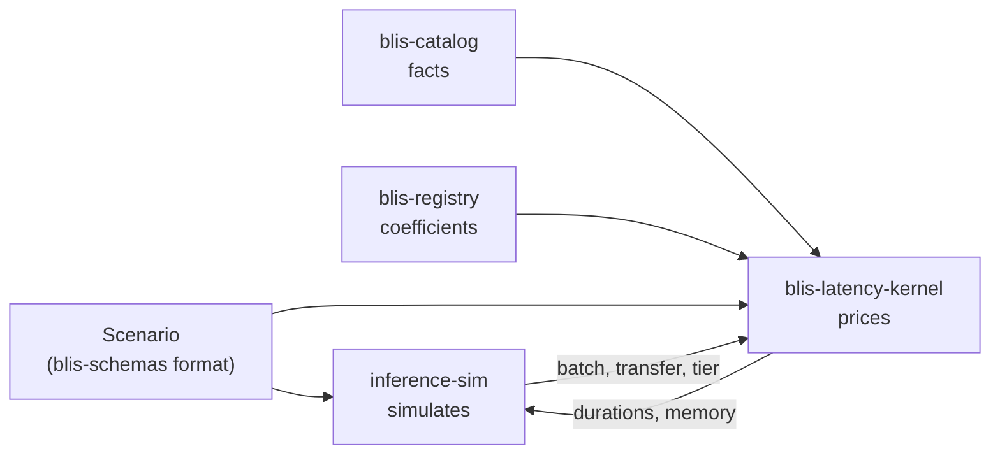
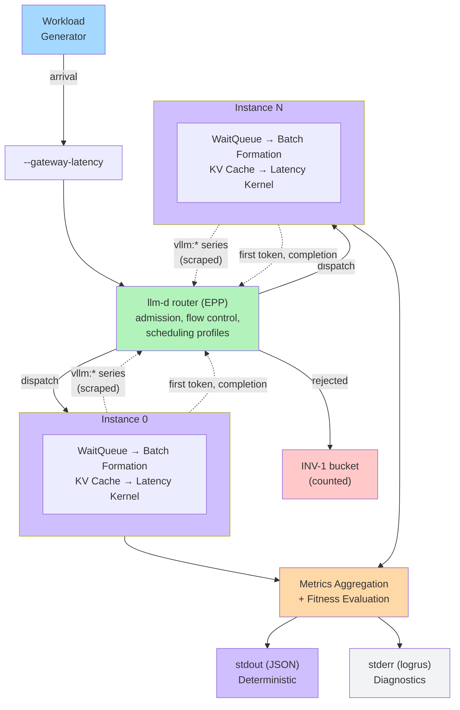

# Cluster Architecture

This page describes how BLIS simulates multi-instance inference serving clusters. For single-instance simulation internals, see [Core Engine](core-engine.md).

> **Canonical sources:** Signal freshness (INV-7) and run/replay parity (INV-13) are defined in [`docs/contributing/standards/invariants.md`](../contributing/standards/invariants.md); the router's inputs and supported plugins in [Routing](../guide/routing.md). If descriptions here diverge, those pages are authoritative.

## The BLIS repositories

BLIS is five repositories, each owning one kind of thing:

| repository | role | owns |
|---|---|---|
| **inference-sim** (this repo) | simulates | the end-to-end simulation: arrivals, the hosting of the llm-d router, scheduling, KV block accounting, placement, metrics |
| **blis-latency-kernel** | prices | step time, KV and fixed memory, P/D KV transfer, offload tier transfer, host overheads |
| **blis-catalog** | states the facts | declared vendor facts: model graphs and configs, chips, fabrics, storage devices, workload presets |
| **blis-registry** | holds what was fitted | coefficient sets, each with its provenance and the range it holds over |
| **blis-schemas** | defines the formats | the source of truth for every shared format: scenario, deployment, engine and catalog files, and the kernel interface |

The simulator decides *when* a step runs and *what* it holds; the kernel says *how long* it
takes and *how much* memory is left for KV. A deployment choice -- which chip, how many GPUs,
what parallelism and engine settings -- is neither a fact nor a coefficient, so it lives in
the scenario a run names, not in the catalog or registry. Data the kernel reads is never
copied into this repo: adding a model or chip is a commit to blis-catalog, refitting a
coefficient is a commit to blis-registry. How a scenario reaches the kernel:
[Latency Models](../guide/latency-models.md).

## Overview

A BLIS cluster is N independent inference instances driven by one shared-clock event loop,
with the llm-d router (the Endpoint Picker) embedded in front of them. BLIS has no routing,
admission or flow-control logic of its own: every request is admitted, queued and placed by
the router's own code (package `sim/llmd`, built on the
[inference-sim fork of llm-d-router](../contributing/llm-d-router-fork.md)), configured by the
same EPP flags, `EndpointPickerConfig` and manifests a deployment gives it.

A single-instance run goes through the router too. The router can only pick that instance, but its admission and flow control still apply; with the default configuration it admits every request on arrival, so the results equal those of the instance alone (`sim/llmd/single_instance_test.go`).

## Shared-Clock Event Loop

The cluster simulator maintains a single global clock shared across all instances. At each iteration, it compares the earliest cluster-level event (request arrival, router work, P/D transfer, autoscaling) against the earliest per-instance event (step completion, queueing), and processes whichever is earlier.

**Ordering rules:**
- Cluster events at time T are processed before instance events at time T (cluster-first priority)
- When multiple instances have events at the same time, the instance with the lowest index goes first
- Router callbacks run at `PriorityGatewayRequest` (after the arrival, before P/D transfer and autoscaling); its background work runs at `PriorityGatewayBackground`, after every other cluster event at the timestamp
- Within a single instance, events are ordered by `(timestamp, priority, seqID)` — the same three-key scheme used at the cluster level

The simulation terminates when the clock exceeds the configured horizon or only daemon events remain. While the router holds requests and nothing but its timers can happen, the run continues for at most one simulated hour (`gatewayStallLimitUs`) before it ends with a warning.

## The Gateway Seam

The cluster talks to the router through the `Gateway` interface (`sim/cluster/gateway.go`).
The cluster hands it each arrival (`OnArrival`) and reports what happens to a dispatched
request (`OnDispatched`, `OnFirstToken`, `OnDone`) and to instances (`OnInstanceChange`). The
gateway acts on the cluster only through `GatewayHost`: it reads the clock and the instances,
schedules events, and calls `Dispatch` or `Reject`. `sim/llmd.Gateway` is the production
implementation; `sim/cluster` unit tests use a small round-robin fake.

## Request Path

1. **Arrival.** A `ClusterArrivalEvent` at the request's arrival time hands the request to
   the gateway.
2. **Gateway latency.** After `--gateway-latency` µs (the network and proxy hops before the
   Endpoint Picker), the router sees the request as Envoy would hand it over: an OpenAI
   `/v1/completions` body with the prompt token IDs, `max_tokens` and `stream`, and the
   `x-llm-d-inference-objective` (SLO class) and `x-llm-d-inference-fairness-id` (tenant)
   headers.
3. **Router request handling.** The router's request handler, parser and Director run in a
   coroutine: admission, flow control (which may hold the request across simulated time), and
   the scheduling profiles' filters, scorers and picker. The decision itself takes zero
   simulated time.
4. **Dispatch or rejection.** The picked endpoint serves the request; under disaggregation,
   the prefill endpoint named by the `disagg-profile-handler` runs the prefill, the KV transfer
   is priced by the latency kernel, and the picked endpoint decodes. A request the router does
   not dispatch lands in exactly one INV-1 bucket (see [Admission Control](../guide/admission.md#outcomes-and-inv-1)).
5. **Instance processing.** The request enters the instance's wait queue and follows the
   single-instance lifecycle (see [Core Engine](core-engine.md)).
6. **Response hooks.** The router sees the response headers when the engine accepts a
   streaming request, the first chunk when the first token is delivered, and the final chunk
   with `usage` when the response completes (a non-streaming response arrives whole at
   completion), so its response plugins (in-flight load, prefix-cache producers) update as in
   a deployment.
7. **Metrics.** Request metrics (TTFT, E2E, ITL) are recorded at instance level and
   aggregated at cluster level.

## What the Router Observes

Each engine publishes vLLM's Prometheus series at the end of every step
(blis-vllm `compat/engine/engine_metrics.go`): `vllm:num_requests_waiting`, `vllm:num_requests_running`,
`vllm:kv_cache_usage_perc`, `vllm:num_preemptions_total`, `vllm:cache_config_info` and, with
LoRA, `vllm:lora_requests_info`. The router scrapes them through its own metrics data source
on its own schedule (the EPP flag `--refresh-metrics-interval`), with each endpoint's phase
offset by up to `--epp-scrape-jitter`. A scrape that lands while a step runs sees the previous
step's values. Endpoints present at the start of a run have been scraped once already;
endpoints added later start unscraped. Signal staleness is therefore the scrape's, as in a
deployment (INV-7). Instances are pods of the pool, ready while routable and not ready while
loading, draining or terminating.

## The DES Hosting Runtime

The router is written for wall-clock time and goroutines. The fork routes every clock read,
background loop, blocking wait, random draw and outbound HTTP call through a `hosting.Runtime`;
`sim/llmd/runtime.go` implements it on the cluster's event loop:

- **Virtual clock.** `Now()` is a fixed epoch plus the simulation clock; tickers, timers and
  deadlines are cluster events.
- **Coroutines under one baton.** Each router goroutine runs as a coroutine
  (`sim/llmd/coroutine.go`). Exactly one of the simulation goroutine and the router's
  coroutines runs at a time; a coroutine parks before it blocks and resumes, in spawn order,
  once its wait condition holds.
- **Seeded streams.** Random draws come from named streams seeded from the run seed, and map
  iteration that affects a decision is sorted, so a run is deterministic (INV-6).
- **Daemon background events.** The router's background work (metrics collection, flow-control
  ticks, cleanup) runs as daemon events at `PriorityGatewayBackground`, after every other
  cluster event at the same timestamp. Daemon events never keep a simulation alive on their
  own.
- **Idle fast-forward.** When no request is anywhere in the router or the engines and the next
  non-daemon event is in the future, the router's loops run only their last ticks before it,
  each keeping its phase (`FastForwardIdle`). It is skipped when a data source polls at its own
  cadence.
- **Simulated HTTP.** Outbound calls are served in-process: `/metrics` returns an engine's
  published series, `/v1/completions/render` the prompt's token IDs (`sim/llmd/server.go`).

Plugins that cannot be hosted faithfully are refused at startup (`sim/llmd/support.go`; the
list is in [Routing](../guide/routing.md#refused-at-startup)).

## Counterfactual Regret

With `--trace-level decisions`, each routing record carries the scores the router's primary
scheduling profile gave every endpoint. `--counterfactual-k` ranks them and records the top k
with their instance state, and `regret = best_score - chosen_score` (clamped to >= 0). With
`max-score-picker` the regret is zero unless the picker broke a tie; random pickers give
non-zero regret.

## Metrics Aggregation

After simulation completes, per-instance metrics are aggregated into a unified cluster result:

| Metric Category | Aggregation |
|-----------------|-------------|
| TTFT, E2E | Combined across all instances. JSON output: mean, p90, p95, p99. Internal `Distribution`: also p50, min, max (used by fitness evaluation). ITL: mean, p90, p95, p99 in JSON output. |
| Throughput | Total output tokens / simulation time; total requests / simulation time |
| Request counts | Sum of completed, queued, running, preempted, dropped across instances |
| Per-SLO-class | Separate distributions per SLO class (for multi-tenant analysis) |
| Fairness | Jain Fairness Index across tenant throughputs |

### Fitness Evaluation

When `--fitness-weights` are configured, BLIS computes a single fitness score from the aggregated metrics. This enables automated policy comparison:

- Latency metrics (TTFT, E2E) are normalized via `1/(1 + value/1000)` where `value` is in ticks (microseconds) and 1000 ticks = 1ms is the reference point (lower latency = higher score). For example, TTFT of 50,000 ticks (50ms) maps to `1/(1+50) = 0.0196`.
- Throughput metrics are normalized via `value/(value + reference)` where `referenceRPS = 100.0` and `referenceTPS = 10000.0` (higher throughput = higher score)
- Normalized scores are multiplied by their configured weights and summed
- Higher fitness = better performance

Note: the normalization compresses raw metric differences significantly. A 38% TTFT improvement might map to only an 8% fitness score difference. Always examine raw metrics alongside fitness scores.

## Instance Isolation

Each instance in the cluster is a fully independent single-instance simulator with its own:
- Event queue and simulation state
- Wait queue and running batch
- KV cache (block allocation, prefix caching, LRU eviction)
- Latency model
- Scheduling and priority policies

Instances share the global clock but have no direct communication. All coordination between
instances happens through the router, which sees them only through their published metrics and
the requests it has routed. This matches real inference serving clusters, where instances are
independent processes.

## Replay

`blis replay` runs a captured TraceV2 (one exported by `blis run --trace-output`, or one
produced by `blis convert weka|otel|inference-perf|servegen`) through the same DES pipeline
and the same scenario-driven deployment path as `blis run`. A run's exported trace replayed
with identical flags (including `--horizon`) yields byte-identical stdout (INV-13). The trace
header records the router inputs (EPP flags with the configuration inlined, manifests, pod
labels, gateway latency, scrape jitter, KV-event delay), so a replay rebuilds the same router; a replay whose
scenario `router:` block, pool labels or router environment flags state a different router is
refused.
`blis observe` and `blis calibrate` are deprecated
([#1901](https://github.com/inference-sim/inference-sim/issues/1901)). See
[Observe / Replay / Calibrate](../guide/observe-replay-calibrate.md) and the
[Configuration Reference](../reference/configuration.md).
