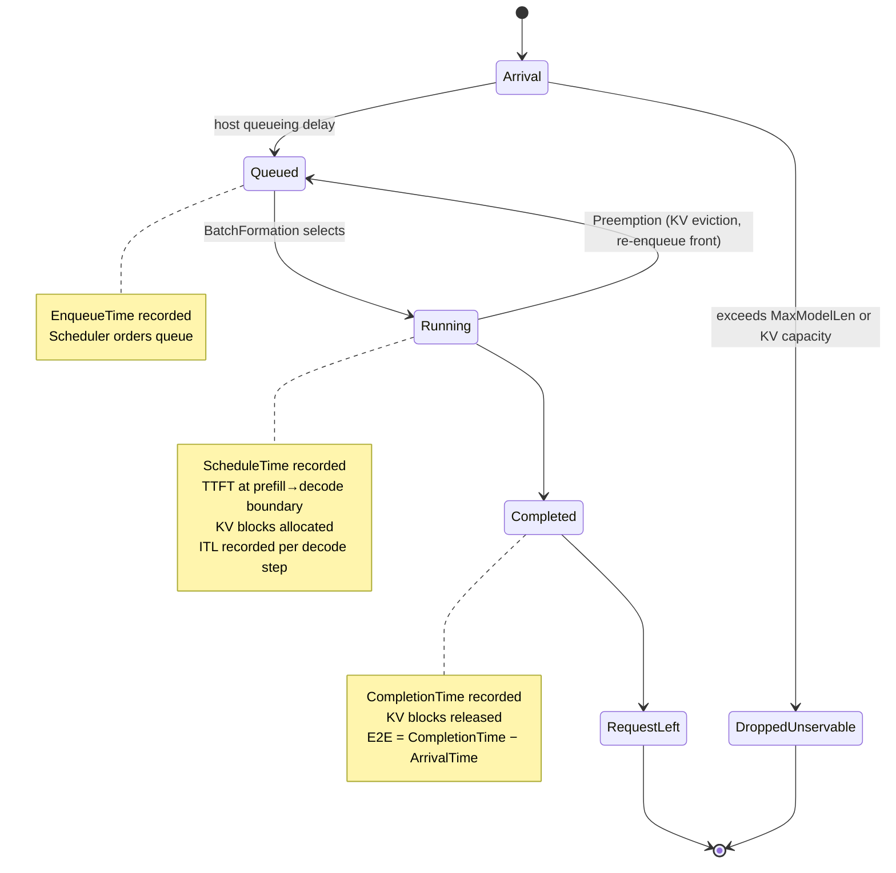

# Core Engine

This page describes BLIS's single-instance discrete event simulation engine. For multi-instance cluster orchestration, see [Cluster Architecture](architecture.md).

> **Canonical sources:** System invariants (INV-1 through INV-19, plus INV-A, INV-A2, INV-W3, the LoRA family INV-L1-INV-L6, PD disaggregation INV-PD-* and pool/transfer INV-P2-*) are defined in [`docs/contributing/standards/invariants.md`](../contributing/standards/invariants.md). If invariant descriptions here diverge, `invariants.md` is authoritative.

## Overview

Each BLIS instance pairs a host-side driver (`sim.EngineDriver`, `sim/engine_driver.go`) with an
engine it reaches only through blis-schemas' `engine.Engine` interface. The driver owns the
clock and the event queue, the client timeouts and the metrics; the engine makes every
scheduling, KV-cache and output decision and prices its own steps. The engine is
[blis-vllm](https://github.com/inference-sim/blis-vllm), built at one site,
`cmd/engine_build.go`, for the scenario's `engine_version`:

- `"0.32.0"`: blis-vllm's translated vLLM v0.32.0 engine;
- `"0.29.0"`, `"0.31.0"`: blis-vllm's compatibility engine, whose output is unchanged from
  earlier BLIS releases.

A scenario with no `engine_version` is refused. The core loop is:

```
while events remain and clock < horizon:
    event = pop earliest event from queue
    advance clock to event.timestamp
    execute event (may produce new events)
```

## The engine interface

The driver turns its events into calls on `engine.Engine`:

| Driver event | Engine calls | Effect |
|---|---|---|
| arrival (`driverArrivalEvent`) | — | prices the request's front-end time (rendering, tokenization) and schedules its hand-off |
| queued (`driverQueuedEvent`) | `Add` | the request enters the engine's waiting queue |
| step start | `Schedule`, then `StepTime` | the engine forms the next batch, as vLLM's scheduler does, and says how long it runs |
| step end (`driverStepEnd`) | `Complete` | the engine applies the batch's output: emitted tokens, first tokens, finishes, KV events |
| wake (`driverWakeEvent`) | `Schedule` | the engine asked to be stepped at an instant (`NextWake`) |
| timeout (`driverTimeoutEvent`) | `Finish` | a client deadline ends the request |

`InFlightLimit` bounds the batches in flight (vLLM's `max_concurrent_batches`: 2 under async
scheduling), and `Metrics`/`Snapshot` give the engine's `vllm:*` series and state for the
router's scrapes and the report. Batch formation, preemption, prefix caching, speculative
decoding, data parallelism and the KV cache are the engine's: see blis-vllm's
[README](https://github.com/inference-sim/blis-vllm#readme) and its
[feature matrix](https://github.com/inference-sim/blis-vllm/blob/main/docs/feature-matrix.md).

## Request Lifecycle

Requests follow a linear state machine with one exception (preemption):



> **INV-5 (Causality):** ArrivalTime ≤ EnqueueTime ≤ ScheduleTime ≤ CompletionTime

### States

| State | Description |
|-------|-------------|
| **Queued** | In wait queue, not yet in running batch. Ordered by scheduling policy. |
| **Running** | In running batch, actively being processed. Progressing through prefill or decode. |
| **Completed** | All output tokens generated. KV blocks released. Metrics recorded. |

### Key Timestamps

These are the conceptual timestamps in a request's lifecycle. Some are stored as struct fields (e.g., `ArrivalTime`, `FirstTokenTime`), while others are computed at metric recording time.

| Timestamp | When Recorded | Used For |
|-----------|---------------|----------|
| Arrival time | Request creation | E2E and scheduling delay baseline |
| Enqueue time | After host queueing delay | Conceptual start of wait queue residence |
| Schedule time | Batch formation selects request | Scheduling delay = time in wait queue |
| First token time | End of prefill phase | TTFT = FirstTokenTime (stored on Request) |
| Completion time | All tokens generated | E2E = FirstTokenTime + sum(ITLs) |

**Causality invariant (INV-5):** `arrival_time <= enqueue_time <= schedule_time <= completion_time`

### Preemption

When KV cache pressure forces eviction, running requests are preempted:
1. Request is removed from the running batch. By default (`--preemption-policy fcfs`), the tail of the batch is evicted. With `--preemption-policy priority`, the running request with the lowest SLO tier priority is evicted first (background before sheddable before batch before standard before critical); among equal-priority requests, the most recently arrived is evicted.
2. Its KV blocks are freed
3. It is re-enqueued at the front of the wait queue (not the back)
4. A debug log is emitted and `PreemptionCount` is incremented

Preempted requests reset to the beginning of prefill (ProgressIndex = 0) and their KV blocks are freed. However, the freed blocks' prefix hashes are preserved in the KV cache's free list — when the request is re-scheduled, prefix caching may find these blocks (if not yet evicted by LRU), reducing recomputation. This matches vLLM's "recompute" preemption mode.

### Dropped Requests

Requests are dropped as unservable at enqueue time (incrementing `DroppedUnservable`) via two guards:

1. **MaxModelLen guard** — requests whose total sequence length exceeds the context window are rejected. When the request declares an output budget (`MaxOutputLen > 0`), the check is `input + budget > maxModelLen`. Otherwise, input length alone is checked (vLLM defaults `max_tokens` to `max_model_len - seq_len`; the runtime stop in `processCompletions` handles output growth).
2. **KV capacity guard** — requests whose input tokens require more KV blocks than the total cache capacity are rejected. This prevents livelock where the simulator would endlessly preempt and re-enqueue a request that can never fit.

Both guards fire before the request enters the wait queue, mirroring vLLM's pre-engine rejection. Additionally, a proactive cap in `FormBatch` clamps token scheduling to `maxModelLen - 1 - ProgressIndex` (matching vLLM `scheduler.py:773-774`), a decode guard in `executeBatchStep` prevents phantom token generation when 0 tokens are allocated, and `processCompletions` force-completes any request whose `ProgressIndex` reaches `MaxModelLen - 1`. Output tokens per length-capped request: `MaxModelLen - len(InputTokens)`, matching vLLM's `check_stop` (`num_tokens >= max_model_len`). `ProgressIndex` is BLIS's `num_computed_tokens`, which lags the generated-token count by one — BLIS charges the first output token to prefill completion, as vLLM's `num_computed_tokens` lags `num_tokens` by the token the forward pass has just appended — so the `MaxModelLen - 1` boundary is reached with the final token already generated, and it is counted.

## Latency Models

Step time and host overheads come from **blis-latency-kernel**. The engine asks the kernel to
price each batch it forms (blis-vllm's kernel adapter, `compat/kernelmodel`), from the model
graph, chip and coefficients the scenario names; the 0.32.0 engine is priced with the kernel's
0.31.0 tuning, and a run says so on stderr. See the
[Latency Models guide](../guide/latency-models.md).

Host overheads are charged around the GPU step, never on it:

- **Queueing time** (tokenization, preprocessing) delays request enqueue but does not block
  the server; the simulation clock is not advanced by it.
- **Output token processing time** (detokenization, streaming) is added to per-request
  ITL/TTFT metrics but does not block the next step.
- **Post-decode fixed overhead** is charged once per request at completion.

This matches vLLM, where CPU post-processing runs concurrently with GPU execution.

## Scheduling Policies

Scheduling policies control the order in which queued requests are selected for batch formation. They operate per-instance, on the compatibility engine (`engine_version` 0.29.0 and 0.31.0); on 0.32.0 the engine orders by its engine block's `scheduling_policy`, and priority scheduling is refused for now. To add a new scheduling policy, see [Extension Recipes](../contributing/extension-recipes.md).

| Policy | Ordering Rule | Use Case |
|--------|---------------|----------|
| `fcfs` | No reordering (arrival order) | Default, fair |
| `priority-fcfs` | Priority **ascending** (lower value = more urgent, vLLM convention), then arrival ascending | SLO-aware scheduling with `slo_class` in workload spec |
| `sjf` | Input token count ascending, then arrival ascending | Shortest-job-first for TTFT optimization |
| `reverse-priority` | Priority descending (highest value = least urgent scheduled first) | Pathological testing only |

Request priorities are **static** — set once at enqueue via `SLOPriorityMap.InvertForVLLM(SLOClass)` (vLLM convention: lower integer = more urgent). Default mapping: `critical=0`, `standard=1`, `batch=5`, `sheddable=6`, `background=7`. No per-step recomputation.

## Metrics

BLIS records per-request and aggregate metrics throughout the simulation.

### Per-Request Metrics

| Metric | Definition |
|--------|------------|
| **TTFT** | Time from arrival to first token: includes queueing delay, prefill step times, and per-token output processing overhead |
| **E2E** | `FirstTokenTime + sum(ITLs)`, where each ITL includes step time + per-token output processing |
| **ITL** | Observed time between consecutive decode steps (includes per-token output processing) |
| **Scheduling Delay** | Time from request arrival to entering the running batch (includes host queueing overhead + wait queue residence) |

### Aggregate Metrics

| Metric | Aggregation |
|--------|-------------|
| TTFT, E2E, ITL distributions | Mean, p90, p95, p99 in JSON output. Cluster-internal `Distribution` type also computes p50, min, max for fitness evaluation. |
| Throughput | Output tokens per second, requests per second |
| Preemption count | Total KV cache evictions |
| KV allocation failures | Failed block allocations |
| Dropped unservable | Requests too large for cache |

### Conservation Invariant (INV-1)

At simulation end, for a **single-instance** run: `injected_requests == completed_requests + still_queued + still_running + dropped_unservable + timed_out`

That five-term form is the single-instance specialisation, not the general rule. The canonical form is an eleven-term cluster equation: a cluster run adds six buckets for the embedded llm-d router's outcomes — routing rejections, flow-control queue depth and capacity rejections, in-flight eviction, TTL expiry, and encode-pool routing. Asserting the five-term form against cluster output is incomplete — see canonical [INV-1](../contributing/standards/invariants.md) for the full equation and the shared helpers that implement it.

This is the fundamental accounting invariant that ensures no requests are silently lost.

## Determinism

BLIS guarantees deterministic output: the same seed produces byte-identical stdout across runs (INV-6).

Key mechanisms:
- **Partitioned RNG:** Each subsystem (workload generation, scheduling, etc.) uses an independent random stream derived from the seed, so adding randomness to one subsystem doesn't perturb others
- **Sorted map iteration:** Where map iteration order affects output, keys are sorted first
- **Stdout/stderr separation:** Deterministic results go to stdout; wall-clock timing and diagnostics go to stderr via logrus
